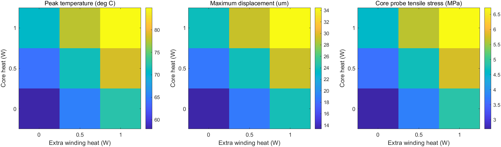

# 课程项目验收记录（2026-10-26）

本次在已有 B 电气收敛检查和候选 L/R 回填复验的基础上，补充当前 C 入口的网格比较、热源敏感性，以及原网页的真实浏览器流程。外部大模型服务按用户要求暂缓，单独保留为未完成项。

## 数值验证

使用 MATLAB R2023b Update 7 和 PDE Toolbox，读取额定候选运行 `c954210e452f/212f0bc8dcae` 的完整电流数据：最后四周期 1,280,000 点，2.310805 Arms、3.739403 A 峰值。三档仅改变磁场和热结构的 Hmax，空气域 80 mm、几何、材料、热源和约束不变。

预先规定中/细网格相对差：电感、中心柱截面平均峰值磁密、温升和位移各小于 2%，固定探针拉应力小于 5%。相对差以细网格值为分母，温度比较使用温升，避免环境温度稀释误差。

| Hmax / mm | L / mH | 截面平均峰值磁密 / T | 温升 / K | 最大位移 / μm | 探针拉应力 / MPa | 角点最大拉应力 / MPa |
|---:|---:|---:|---:|---:|---:|---:|
| 3 | 1.909026 | 0.148671 | 31.435866 | 23.980344 | 4.883314 | 57.136886 |
| 2 | 1.909072 | 0.148669 | 31.435515 | 23.943107 | 4.753132 | 59.561701 |
| 1 | 1.910218 | 0.148748 | 31.438846 | 23.912992 | 4.709484 | 69.067636 |

| 对比 | L差 / % | 磁密差 / % | 温升差 / % | 位移差 / % | 探针应力差 / % | 结果 |
|---|---:|---:|---:|---:|---:|---|
| 粗/中 | 0.002378 | 0.001090 | 0.001115 | 0.155524 | 2.738853 | 通过 |
| 中/细 | 0.060028 | 0.053008 | 0.010596 | 0.125935 | 0.926820 | 通过 |

这证明所列观测量在本算例的相邻网格间较稳定。电感误差并未逐档单调减小，不据此推算收敛阶；空气域截断误差也不在这次比较中。角点最大应力随加密继续增加，明确不计入通过项，不作为结构强度结论。

| Hmax / mm | 磁场节点 / 三角形 | 热及结构节点 / 三角形 | 磁场最小质量 | 热及结构最小质量 | 磁场求解 / s | 热结构求解 / s | 入口总耗时 / s |
|---:|---|---|---:|---:|---:|---:|---:|
| 3 | 16497 / 8142 | 4045 / 1976 | 0.79845 | 0.69537 | 1.78 | 3.60 | 26.90 |
| 2 | 31837 / 15758 | 6897 / 3380 | 0.80993 | 0.80480 | 1.96 | 4.17 | 25.09 |
| 1 | 119125 / 59242 | 21899 / 10812 | 0.77021 | 0.79715 | 4.43 | 7.57 | 32.74 |

质量定义为 `4√3×三角形面积/三边长度平方和`，取二次单元的三个角节点。总耗时包含读写与出图，不含 MATLAB 进程启动；三档时间不用于性能基准结论。原始精度、质量中位数、能量平衡及求解源码哈希保存在[数值摘要](evidence/course_acceptance_20261026/field_summary.json)。

各网格四图：

- 3 mm：[磁场](evidence/course_acceptance_20261026/mesh/coarse/magnetic.png)、[温度](evidence/course_acceptance_20261026/mesh/coarse/thermal.png)、[应力](evidence/course_acceptance_20261026/mesh/coarse/structural.png)、[位移](evidence/course_acceptance_20261026/mesh/coarse/displacement.png)。
- 2 mm：[磁场](evidence/course_acceptance_20261026/mesh/medium/magnetic.png)、[温度](evidence/course_acceptance_20261026/mesh/medium/thermal.png)、[应力](evidence/course_acceptance_20261026/mesh/medium/structural.png)、[位移](evidence/course_acceptance_20261026/mesh/medium/displacement.png)。
- 1 mm：[磁场](evidence/course_acceptance_20261026/mesh/fine/magnetic.png)、[温度](evidence/course_acceptance_20261026/mesh/fine/thermal.png)、[应力](evidence/course_acceptance_20261026/mesh/fine/structural.png)、[位移](evidence/course_acceptance_20261026/mesh/fine/displacement.png)。

## 热源敏感性

保持电流、40°C 环境及 h=10 W/(m²·K) 不变。复用 1 mm 网格的单位绕组热、单位磁芯热响应，九种组合分别重新求铜阻温度反馈；不是九次独立有限元求解。中心组合的温度及位移与原细网格结果的差小于 10⁻⁶°C、10⁻⁶ μm。

| 附加绕组热 / W | 磁芯热 / W | 最高温度 / °C | 最大位移 / μm | 探针拉应力 / MPa |
|---:|---:|---:|---:|---:|
| 0 | 0 | 57.955 | 13.346 | 2.696 |
| 0 | 0.5 | 64.244 | 18.565 | 3.629 |
| 0 | 1 | 70.536 | 23.785 | 4.562 |
| 0.5 | 0 | 65.150 | 18.694 | 3.776 |
| 0.5 | 0.5 | 71.439 | 23.913 | 4.709 |
| 0.5 | 1 | 77.730 | 29.133 | 5.643 |
| 1 | 0 | 72.345 | 24.042 | 4.857 |
| 1 | 0.5 | 78.634 | 29.261 | 5.790 |
| 1 | 1 | 84.923 | 34.480 | 6.723 |

上表为给定热源的参数研究。温度跨度约 27°C，说明最终温度对附加热源有明显依赖；不能把基准 0.5 W 当成已经建立的磁芯或交流铜损预测。精确数值以[敏感性结果](evidence/course_acceptance_20261026/sensitivity/sensitivity.json)为准。

## 浏览器全流程

实际使用 Chrome 155.0.8059.85、Playwright 1.64.1、本地 HTTP 服务和 MATLAB R2023b Update 7。会话 `d53e6ef3e11e` 与日常会话隔离；模型服务在本次进程中关闭。两次电气运行均为 400 步/开关周期，不能代替此前 400/800 步对比。

| 修订 | 电气运行 | 输出 / Vrms | THD(2—40次) / % | 用途 |
|---|---|---:|---:|---|
| 1 | `8e24b90ed43e` | 219.687612 | 1.726813 | 2 mH / 0.25 Ω 基准 |
| 2 | `a20b1a8f3475` | 219.686265 | 1.689188 | 从基准场结果准确回填 L/R20 后重算 |

本次网页回填读取本次 400 步父运行的场结果，与先前 800 步研究使用的电流峰值存在差别。完整参数保存在[浏览器记录](evidence/course_acceptance_20261026/browser/acceptance.json)，不同运行的数字不互相替换。

| 验收项目 | 结果 | 证据 |
|---|---|---|
| 参数页设置闭环、20 kHz、500 W | 通过 | [参数页](evidence/course_acceptance_20261026/browser/screenshots/01_parameters.png) |
| 基准与候选两轮电气、场求解 | 通过，均为真实 MATLAB 执行 | [候选结果](evidence/course_acceptance_20261026/browser/screenshots/06_candidate_fields.png) |
| 四张场图加载及归属 | 通过 | [磁场](evidence/course_acceptance_20261026/browser/screenshots/06_candidate_fields_field_1.png)、[温度](evidence/course_acceptance_20261026/browser/screenshots/06_candidate_fields_field_2.png)、[应力](evidence/course_acceptance_20261026/browser/screenshots/06_candidate_fields_field_3.png)、[位移](evidence/course_acceptance_20261026/browser/screenshots/06_candidate_fields_field_4.png) |
| 候选回填产生新修订、保存来源 | 通过 | [旧修订提示](evidence/course_acceptance_20261026/browser/screenshots/04_stale_revision.png) |
| 拒绝旧修订作为当前场输入 | 通过，预期任务失败 | [拒绝记录](evidence/course_acceptance_20261026/browser/stale_rejected_job.json) |
| 历史选择与刷新 | 通过，进入指定会话后默认显示其最新成功运行 | [历史](evidence/course_acceptance_20261026/browser/screenshots/07_history.png)、[刷新](evidence/course_acceptance_20261026/browser/screenshots/08_refreshed.png) |
| 结果比较与 SLX 下载 | 通过，下载文件哈希等于源文件 | [验收记录](evidence/course_acceptance_20261026/browser/acceptance.json) |
| 缺少完整 MAT 时拒绝场求解 | 通过，预期任务失败；原文件已恢复并核对哈希 | [拒绝记录](evidence/course_acceptance_20261026/browser/missing_raw_rejected_job.json) |
| MATLAB 运行取消 | 通过，状态为 cancelled | [取消截图](evidence/course_acceptance_20261026/browser/screenshots/10_cancelled.png) |
| Markdown 显示与 HTML/危险链接拦截 | 通过 | [显示截图](evidence/course_acceptance_20261026/browser/screenshots/11_markdown.png) |
| 390 px 手机布局 | 通过，无页面横向溢出 | [手机截图](evidence/course_acceptance_20261026/browser/screenshots/12_mobile.png) |
| 浏览器 JavaScript 未捕获错误 | 本次完成流程为 0 | [验收记录](evidence/course_acceptance_20261026/browser/acceptance.json) |
| 真实外部模型调用新增工具 | **未完成，按用户要求暂缓** | Nanobot 测试提供者回归不替代此项 |

验收脚本曾因页签切换、字符串等待条件触发 CSP，以及恢复运行时另一个会话成为默认会话而中断，已修正并保留在 `recovered_errors`。页面刷新会进入最近更新的会话；恢复验收时如取消测试已创建更新的会话，脚本先重新选择本算例，再检查最新结果，不宣称网页记住了刷新前的会话。

代码审阅另发现完成任务后的页面断言必须与任务状态分开保存。脚本现先记录 `job_completed`，断言与截图完成后才记 `passed`。通过人为中断截图验证，这种情况下恢复运行会重新检查页面，不能跳过失败断言。该受控错误也保留在记录中。已完成的真实求解没有重复计算；最终截图来自实际浏览器，非网页示意图。

## 软件回归与证据范围

Python 3.12 环境下 53 项 unittest 全部通过，包含已安装 Nanobot 0.3.5 后执行的提供者替身测试，无跳过项。前端状态、安全 Markdown、精度说明回归及 JavaScript 语法检查通过；MATLAB 网格参数测试验证默认值、覆盖值及非法输入拒绝。

Nanobot 回归使用测试提供者，验证工具注册与调度，不代表真实外部模型服务通过。网页单次运行仍显示“未开展网格/步长对比”，不会把本研究的结论套到任意设计上。

发布目录只含精简证据，`manifest.json` 记录发布文件的 SHA-256。JSON/日志中的本机项目根目录替换为 `${REPOSITORY}`，文本统一为 LF；这些发布副本的字节哈希与原始工件哈希用途不同。原始电气数据和源码哈希仍原样保留在摘要中，源码原始哈希包含本机行尾差异。`solver_sources/` 另存本次场求解源码的 LF 副本，便于跨平台逐文件核对内容。
