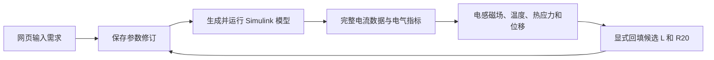

# 单相 DC/AC 逆变器设计与多物理场分析

本项目把单相逆变器的参数设计、Simulink 仿真和滤波电感场分析放在同一个本地网页中。A 负责需求解析、工具调度和网页；B 负责四阶段电气模型；C 负责电感选型及磁、热、力计算。课程最终算例采用电压闭环，并完成一次候选电感参数回填。

本页汇总主要结果，运行编号、误差表和截图见[课程验收记录](COURSE_ACCEPTANCE.md)。真实外部大模型服务的新增工具调用验收按用户要求暂缓，规则模式可以独立完成设计流程。

## 1. 设计条件与计算流程

直流输入 380 V，输出目标 220 Vrms、50 Hz，额定阻性负载 500 W；开关频率 20 kHz，输出电容 4.7 μF。除额定工况外，另检查半载和 0.12 s 从额定降至半载。电气仿真持续 0.24 s，稳态指标由最后四个基波周期 [0.16, 0.24) 的完整采样数据计算。

每次运行保留参数修订、父运行和数据哈希。修改参数后，历史图仍可查看，但会提示它属于旧修订；旧结果不能直接作为当前设计的场求解输入。网页曲线经过抽样显示，电流有效值、峰值及场模型输入均从完整数据读取。

## 2. 四阶段电气模型

| 阶段 | 用途 | 已有验证结论 |
|---|---|---|
| 基础理想开环 | 核对调制与滤波的基本关系 | 三种负载工况的 400/800 步对比通过 |
| 器件开环 | 观察死区及器件模型影响 | 额定、阶跃为 400/800 步，半载为 800/1600 步 |
| 含损耗开环 | 对照损耗对输出的影响 | 三种工况的 400/800 步对比通过 |
| 电压闭环 | 维持输出电压，作为最终设计 | 额定为 400/800 步；半载、阶跃为 1600/3200 步 |

这里的步数指每个开关周期的仿真步数。各组比较使用原定误差阈值，失败的粗步长结果保留在[B 电气验证报告](B_CONVERGENCE_AUDIT_20261026.md)中。未补偿的器件与含损耗开环输出约 206—207 V，低于 220 V±5% 的下限；它们用于说明开环误差，不作为最终达标方案。

THD 指输出电压第 2—40 次整数谐波相对基波的有效值比，不包含所有高频纹波。电感电流带有开关纹波，不能仅凭曲线粗细判断输出电压谐波是否合格。网页将低次 THD 与载波频段指标分开显示。

## 3. 候选电感与一次参数迭代

选用 E70/33/32、N87 材料、68 匝绕组和 2.5 mm 单片气隙的课程候选结构。二维线性磁场与绕组几何计算得到约 1.909072 mH、20°C 电阻 0.216641 Ω。回填使用完整数值，原 2 mH、0.25 Ω 基准保留在原修订中。

额定工况经步长检查的候选结果为 219.68495 Vrms，输出电压 THD(2—40 次) 为 1.65139%，电感电流 2.31081 Arms，峰值 3.73940 A。与基准相比，电压基本保持不变，电流峰值略有上升。电感量减小并不意味着每项性能都改善，需同时检查电流和温度。

半载及降载工况也分别完成回填和重新求解。前后对照、动态指标、六组步长比较及 24 张场图见[L/R 回填报告](LR_ALIGNMENT.md)。这是一轮显式设计迭代；电路采用 R20，热模型内部另算铜阻随温度变化，不构成自动电热双向迭代。

## 4. 磁场、温度与热应力

磁场模型采用二维截面，空气域及材料、气隙与绕组尺寸在三档网格中保持一致。热计算取环境 40°C、外周对流系数 10 W/(m²·K)，附加绕组热和磁芯热基准各取 0.5 W；直流铜损由完整电流有效值和温度相关铜阻计算。结构计算读取温升，输出热位移和热应力。

当前入口的 3、2、1 mm 网格均已完成。中/细网格的电感、中心柱截面平均峰值磁密、温升和位移差分别为 0.0600%、0.0530%、0.0106%、0.1259%，固定探针拉应力差为 0.9268%，满足预先规定的 2%/5% 比较阈值。细网格最高温度 71.43885°C，最大位移 23.91299 μm，探针拉应力 4.70948 MPa。

角点最大拉应力随加密从约 57.14 MPa 上升至 69.07 MPa，不能用探针值稳定来代替角点峰值收敛，也不能据此给出结构强度裕度。磁密指标为截面平均量，不是局部最大磁密或饱和判定。

为说明热源选择的影响，附加绕组热和磁芯热各取 0、0.5、1 W，组合成九种情况。复用细网格单位热源响应，并分别重新求铜阻温度反馈，最高温度范围为 57.96—84.92°C。这些热源是课程算例的给定输入，不是材料损耗模型的预测；九组计算也不写成九次独立有限元求解。

## 5. 软件流程与交付

浏览器验收使用本地 Chrome、真实 HTTP 服务及 MATLAB R2023b Update 7，操作原网页完成设置参数、两轮电气及场求解、候选回填、历史切换、刷新和模型下载。异常路径包括旧修订拒绝、缺失完整原始数据拒绝和运行取消。具体状态以[验收矩阵](COURSE_ACCEPTANCE.md)及其机器可读记录为准。

交付包含源代码、复现脚本、数值摘要、日志、场图、网页截图和演示步骤。MAT/SLX 等完整工件留在本地输出目录，不随 Git 提交；下载功能的原文件和浏览器下载文件用 SHA-256 对照。另见[演示指南](DEMO_GUIDE.md)。

当前结果支持给定课程算例的电气与磁热力分析，不包含材料磁芯损耗预测、交流铜损的独立模型、整机效率、饱和或结构强度认证。真实外部模型服务验收保留为待办，不计入已通过项。
