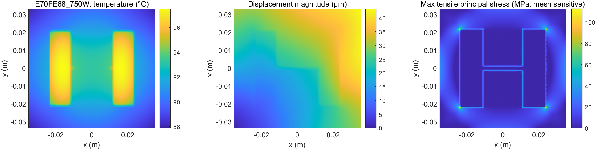

# C 分工：滤波电感磁—热—力仿真设计

## 设计对象与参数选取

本课程方案采用单相逆变器的输出滤波电感。电气边界取 380 V 直流母线、220 V/50 Hz 输出、20 kHz 开关频率，额定 500 W，同时以 750 W 作高负载复验。完整电感电流由本目录的 Simulink 开关函数模型给出，磁、热、力场由 MATLAB PDE Toolbox 求解。与同一电气模型联动，输出电感 L 和绕组电阻 R 后重新计算电流波形。

磁芯选 [TDK E70/33/32 N87](https://www.tdk-electronics.tdk.com/inf/80/db/fer/e_70_33_32.pdf)：一片 2.5 mm 开隙 `B66371G2500X187` 加一片无隙 `B66371G0000X187`，配一组磁芯用骨架 `B66372B1000T001`。厂商给出 `Ae=683 mm²`、`Ve=102000 mm³`、该气隙约 `AL=435 nH`、骨架窗口 `AN=456 mm²`、平均匝长 `lN=209 mm`。按 `L≈AL N²` 选 68 匝，目录电感约 **2.011 mH**，接近滤波器的 2 mH 目标。

绕组方案采用 68 匝、64 股 × 0.15 mm 铜丝的等效截面积，共 **1.131 mm²**，与 1.2 mm 单股裸铜等面积。20 kHz、20°C 铜的理想集肤深度约 0.467 mm，单股半径 0.075 mm 小于此值；采用多股是为控制集肤效应。按 20°C 铜电阻率 `1.724×10⁻⁸ Ω·m` 与目录平均匝长计算，直流电阻 **0.2166 Ω**；裸铜窗口占比约 **16.9%**。绕组包在二维场模型中按均匀块表示，绝缘后外形按约 1.6 mm 等效束径布置，窗口截面积占比约 **30.0%**。这一面积检查只用于选型，不替代绕制细节。

热—力模型取外周空气对流 `h=10 W/(m²·K)`、环境 `40°C`、前后端面绝热；磁芯 `k=5 W/(m·K)`、等效绕组包 `k=2 W/(m·K)`、填充绝缘区 `k=0.2 W/(m·K)`。结构用两处下部限位消除刚体运动，窗口区按等效绝缘填充与磁芯连接；磁芯弹性模量 150 GPa、泊松比 0.25、线膨胀系数 `8×10⁻⁶/K`。这些是模型的材料与边界输入，具体数值及版本见 `material_assumptions.json`。

## 磁场与电气联动

依据厂商尺寸建立二维线性截面，中心气隙 2.5 mm，绕组块采用对称电流密度。E70 粗、细磁网格为 6.93 万、18.44 万节点，电感分别为 **1.909050、1.909178 mH**，网格变化 **0.0067%**。二维结果比目录 `AL N²` 低 **5.08%**，故 500 W 和 750 W 联动复验均使用二维的 1.909 mH，同时保留目录值对照。750 W 时，电感电流峰值 **5.223 A**、R20 铜阻项 **2.545 W**；体区线性磁通密度随峰值电流换算约 **0.208 T**。

在最后四个 50 Hz 周期内统计 1600 个完整开关周期，750 W 的周期内电流峰峰值均值 **0.947 A**，95 分位 **1.269 A**；按同一线性电感换算的磁通摆幅 95 分位 **52.2 mT**。直流偏置与开关纹波叠加后材料的非线性行为未包含在本轮线性场模型中。

## 波形与谐波

电气波形图用实线表示开关周期平均值，用阴影保留同一周期的电压、电流范围，并附四个开关周期的全采样率电流图。此前直接抽取 3200 点的画法会把高频纹波显示成缓慢起伏，现已替换。图题中的 THD 专指输出电压的 2—40 次谐波；电感电流另外统计，不能共用这一指标。

E70 500 W、400 步模型的输出电压 THD 为 0.1125%，电感电流 THD 为 0.5159%；计入开关频段后，电流宽带非基波比例约为 12.22%。750 W 时三项分别为 0.0893%、0.2724% 和 8.20%。这些结果说明输出电压低次谐波较小，但电感中的高频纹波仍需保留。固定电阻铜损由完整电流均方值计算，已计入纹波电流的贡献；频率相关的附加铜损和磁芯损耗另行作为热源输入。

基准模型增加到每开关周期 1600 步，E70 两个负载工况增加到 800 步，用于复核有效值、峰值、铜损和 THD。具体差值见 [波形与谐波复核](波形与谐波复核.md)。下文热—力结果仍对应原 400 步电气工况；加密结果作为数值检查单独保留。低次 THD 对步长比有效值更敏感，不把有限步长的结果写成精确极限值。

## 温度与结构场

以同一二维几何分别计算 1 W 绕组热源和 1 W 磁芯热源，最高温升系数为 **13.505** 与 **12.184 K/W**。温度驱动线性热弹性模型，结构位移和应力以 40°C 环境作为零温升参考；组合计算对同网格源场进行叠加，并用铜电阻温度系数 `0.00393/K` 迭代更新直流铜损。为给出完整的课程算例，500 W 与 750 W 都取额外绕组热 **0.5 W**、磁芯热 **0.5 W** 作为计算工况输入。

| 工况 | 反馈后直流铜损 | 总绕组热 | 磁芯热 | 最高温度 | 最大位移 | 磁芯选定探针最大拉主应力 |
|---|---:|---:|---:|---:|---:|---:|
| 500 W | 1.389 W | 1.889 W | 0.500 W | **71.42°C** | **23.92 µm** | **4.74 MPa** |
| 750 W | 3.320 W | 3.820 W | 0.500 W | **97.49°C** | **43.32 µm** | **8.68 MPa** |

两组温度、位移、拉主应力云图见 `outputs/e70_combined_scenarios/`。最大拉主应力出现在二维直角/界面角点，网格敏感；表中选定探针值用于同模型方案比较，不把角点峰值当作磁芯强度判定。当前 750 W 温度距本课程采用的 100°C 设计观察值仅约 2.5°C，因而散热与损耗输入对结论敏感。

组合算例采用 2.0 与 1.5 mm 两档热/结构网格复核：750 W 最高温度变化 **0.00052%**，最大位移变化 **0.052%**，磁芯选定探针拉主应力变化 **0.284%**。这验证所列全局温度、位移和探针量的网格稳定性；界面尖角的局部峰值仍不用于判定。

## 对比与结论

原 E55/83 匝候选在 750 W 理想电路中峰值 **5.243 A**，厂商 100°C 直流 10% 电感系数下降参考点约 **4.097 A**；E70/68 匝在相同口径下，厂商参考点约 **6.527 A**、电路峰值 **5.223 A**。这说明扩大有效截面和选用更大气隙的 E70 方案改善了这一筛选指标。E70 磁芯组质量约 514 g，E55 约 215 g，代价是质量与占用空间增加。

本课程的部件改进选择 **E55 → E70**，并完成了修改后的电气、磁场、热与结构联动复验。二维磁场为线性近似，热与结构为所列材料和边界输入下的仿真；0.5 W 两项附加热是本课程的计算工况。报告结论限于这些模型输入，不给出实物磁芯损耗、实际温升或强度安全系数。数值摘要和运行文件分别见 `outputs/study_summary.json`、`outputs/c_study_manifest.json`。

## 复现

组合场网格复核先运行 `run_e70_core_mesh_check`，再运行 `run_e70_combined_scenarios`。

在 MATLAB R2023b Update 7 与 PDE Toolbox 中进入本目录，依次运行 `run_magnetic_e70_study`、`run_e70_fe_500`、`run_e70_fe_recheck`、`run_e70_unit_response`、`run_e70_core_mesh_check`、`analyze_e70_switching_ripple`、`run_e70_combined_scenarios`。`python e70_loss_budget.py` 生成 E70 热源敏感性数据；完整摘要 `python summarize_study.py` 还依赖 E55 和基准电气案例，应先按 [研究说明](研究说明.md) 生成这些前置结果。
